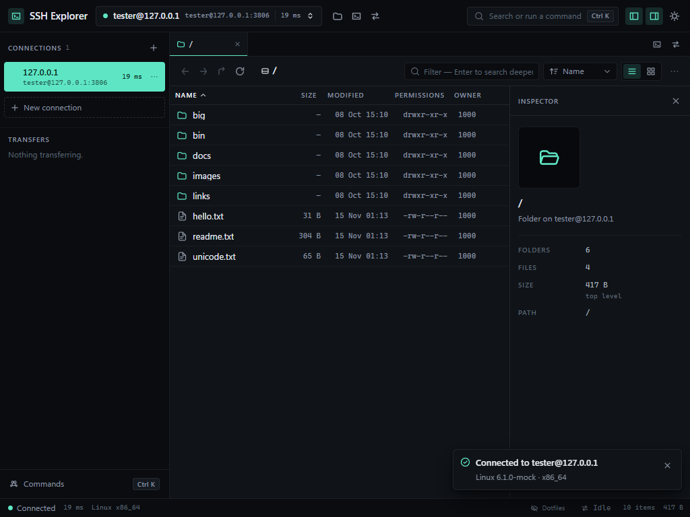

# WooSSH

A file manager and terminal for remote hosts over SSH. It looks and behaves like a desktop
file manager, but everything it shows lives on the server.

## Files

- **Two-panel view** — two folders side by side, `Tab` to move between them, and a chooser
  in each panel header to decide which tab it shows.
- **Tabs** — as many as you like, each remembering its own folder, selection and history.
- **Dense sortable table** — sort by any column, filter as you type, and switch to a grid of
  thumbnails. Long listings stay smooth.
- **Multi-select** — click, `Shift`-click for a range, `Ctrl`-click to add, `Ctrl+A` for all.
  Selections survive sorting, filtering and a refresh.
- **Full file operations** — create, rename, duplicate, move, delete, change permissions.
- **Copy and paste** — `Ctrl+C`, `Ctrl+X`, `Ctrl+V`, with conflicts reported before anything
  is overwritten: skip or replace, your choice.
- **Drag and drop upload** — drop files or whole folders onto a panel, and the folder
  structure is recreated on the server.
- **Folder sizes on demand** — measure a folder and everything under it in one request.
- **Archives** — pack any selection into `zip`, `tar` or `tar.gz`, and unpack one into the
  folder you choose. Works even on a host with no archiver installed.
- **Search** — recursive search from the current folder, with hits shown by their location.
- **File preview** — text, images, and metadata, without downloading anything.
- **Open and edit locally** — open a remote file in whatever application this computer uses
  for it, and send the changes back when you save.
- **Inspect** — size, permissions, owner, timestamps and path for whatever is selected,
  in a panel you can drag to the width you want.

## Transfers

- A **queue** with live progress, speed, ETA and the ability to cancel or retry.
- **Resumable downloads** — an interrupted transfer continues from where it stopped instead
  of starting again.
- **Between two hosts** — copy or move straight from one server to another, without
  dragging the data through your own machine.
- **Speed limit** and a cap on how many transfers run at once.

## Terminal

- A **real PTY** — colours, cursor keys, `Ctrl+C`, interactive programs.
- Several shells at once, each in its own tab, opened in the folder you are looking at.
- Search inside the scrollback, and copy the output.

## Hosts

- Saved hosts with **your own names** and colour tags, so `prod-db` reads better than an
  address.
- **Double-click to connect**, using the credential already stored for that host.
- **Credentials in the system keychain** — on Windows they are sealed by DPAPI, and they are
  never sent back to the interface.
- **Host keys pinned on first trust**, with a manager for reviewing and forgetting them. A
  key that changes is refused rather than accepted quietly.
- **Connection diagnostics** — one report showing what the host can and cannot do, for when
  something does not work and the reason is not obvious.

## Monitoring and tools

- **Server status** — uptime, load, memory, swap and disk usage, with the figures that are
  unavailable explained rather than left blank.
- **Live vitals** in the status bar, refreshed while you are connected.
- **Ping and traceroute** from this computer to a host — no connection needed, so it works
  precisely when connecting does not.
- **Log file** for the desktop build, so a problem can be reported with evidence.

## Interface

- **Command palette** — `Ctrl+K` reaches every action by name.
- **Dark and light themes**, and full English and Russian localisation.
- **Keyboard-first** — arrow keys walk the listing, `Enter` opens, `F2` renames, `Delete`
  removes, `Tab` moves between panels.
- **Resizable everything** — sidebar, inspector and both panels.
